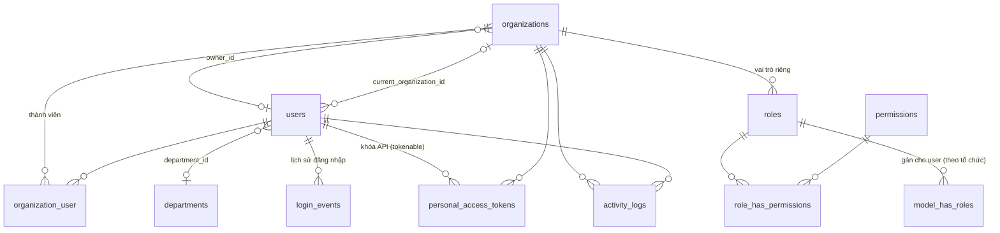
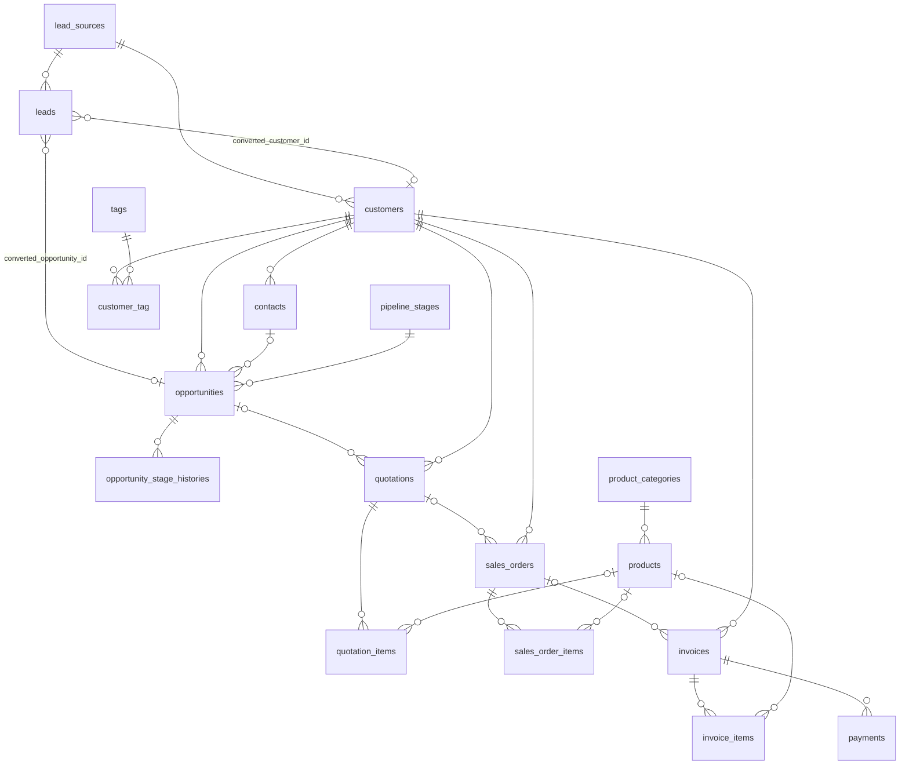
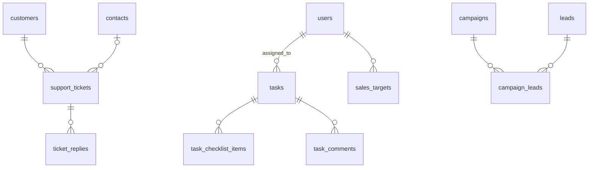

# Cấu trúc database TOP CRM

*Dành cho lập trình viên. Cài đặt, import file SQL, sao lưu/khôi phục: xem [DATABASE_SETUP.md](DATABASE_SETUP.md).*

- Database: `orangecrm_db` · MariaDB 10.11 (tương thích MySQL 8) · InnoDB · `utf8mb4_unicode_ci`.
- **50 bảng**, 97 khóa ngoại. Nguồn sự thật là `database/migrations/`; file `database/sql/orangecrm_db.sql` được tạo lại bằng `scripts/generate-sql.ps1`.
- Database phụ: `orangecrm_test` (chỉ cho `php artisan test`), `orangecrm_preview` (dữ liệu demo để chụp giao diện). Không chứa dữ liệu thật.

## 1. Quy ước chung

| Quy ước | Ý nghĩa |
|---|---|
| `organization_id` | Bản ghi thuộc một tổ chức. Model dùng `BelongsToOrganization` → tự gán + lọc theo tổ chức (fail-closed). Unique nghiệp vụ (mã KH, SKU, tên thẻ...) là **theo tổ chức**. |
| `deleted_at` | Xóa mềm (khách hàng, lead, cơ hội, chứng từ, sản phẩm, công việc, ticket, chiến dịch, người dùng, tổ chức). |
| `is_demo` | `1` = dữ liệu demo; xóa toàn bộ bằng `php artisan crm:purge-demo`. Không bao giờ tính là doanh thu thật. |
| `assigned_to`, `created_by` | Người phụ trách / người tạo → phạm vi dữ liệu cho người không có quyền "xem tất cả". `SET NULL` khi xóa người dùng. |
| `code` | Mã nghiệp vụ (KH00001, LD00001, BG00001, DH00001, HD00001, TK00001...) sinh sau khi insert. |
| Tiền | `DECIMAL(15,2)`, luôn tính lại ở backend. |

## 2. Sơ đồ quan hệ (ERD)

### 2.1 Tổ chức, người dùng, phân quyền, bảo mật

### 2.2 Bán hàng

### 2.3 Vận hành

`interactions` và `attachments` là quan hệ đa hình (`*_type`, `*_id`) gắn vào khách hàng, lead, cơ hội, công việc... (tên ngắn trong `Relation::morphMap`).

## 3. Danh sách bảng

### Tổ chức & tài khoản
| Bảng | Mô tả |
|---|---|
| `organizations` | Doanh nghiệp dùng hệ thống (tên, slug, trạng thái active/suspended, chủ sở hữu). `id = 1` là tổ chức mặc định. |
| `organization_user` | Tư cách thành viên: `status` active / invited / suspended, `joined_at`. |
| `users` | Tài khoản (dùng chung giữa các tổ chức): email, username, mật khẩu bcrypt, `is_platform_admin`, `locale`, `theme`, `current_organization_id`, trạng thái, cột 2FA (`two_factor_secret` & `two_factor_recovery_codes` mã hóa bằng APP_KEY, `two_factor_confirmed_at`, `two_factor_last_step`), `email_verified_at`. |
| `departments` | Phòng ban theo tổ chức. Phòng ban của người dùng lưu ở `organization_user.department_id` (từ bước 2.1; `users.department_id` cũ không còn dùng). |
| `organization_settings` | Cài đặt riêng của từng tổ chức (khóa–giá trị, unique theo tổ chức). |
| `roles`, `permissions`, `role_has_permissions`, `model_has_roles`, `model_has_permissions` | spatie/laravel-permission chế độ teams: `roles.organization_id`, `model_has_roles.organization_id`. |
| `login_events` | Lịch sử đăng nhập (sự kiện, phương thức, IP, user-agent, băm cookie thiết bị, thiết bị mới). Tự xóa sau 180 ngày. |
| `personal_access_tokens` | Khóa API Sanctum: chỉ lưu băm SHA-256, `abilities`, `organization_id`, `expires_at`, `last_used_at`, `last_used_ip`. |
| `password_reset_tokens`, `sessions` | Mặc định Laravel (phiên lưu trong DB để xem/đăng xuất thiết bị). |

### Bán hàng
| Bảng | Mô tả |
|---|---|
| `lead_sources` | Nguồn khách (Website, Giới thiệu...). |
| `leads` | Khách tiềm năng: điểm, giai đoạn (`status` = mã trong `lead_stages`, chuỗi), giá trị dự kiến, liên kết khi chuyển đổi; từ bước 2.4: `qualified_at`, `lost_reason_id` + `lost_note`, đồng ý marketing (`marketing_consent`, `_at`, `_source`). |
| `lead_stages` | Giai đoạn lead của từng tổ chức (`key`, tên, màu, thứ tự, `is_system` cho converted/lost, `is_qualified`). |
| `lost_reasons` | Lý do thất bại của từng tổ chức (`applies_to`: lead / opportunity / both). |
| `customers` | Khách hàng (cá nhân/doanh nghiệp), người phụ trách, nguồn, thẻ; từ bước 2.3: `country` (ISO 2 ký tự), `segment`, `lifecycle_stage` + `lifecycle_changed_at`, `preferred_channel`, `marketing_consent` + `_at` + `_source`, `custom_fields` (JSON), `merged_into_id` (bản đã gộp). |
| `custom_field_definitions` | Trường tùy biến của từng tổ chức (`entity`, `key` duy nhất theo tổ chức, `type`, `options`, bắt buộc/ẩn, thứ tự). |
| `contacts` | Người liên hệ của khách hàng doanh nghiệp. |
| `tags`, `customer_tag` | Thẻ phân loại khách hàng. |
| `pipeline_stages` | Giai đoạn pipeline (thứ tự, xác suất, Thắng/Thất bại). |
| `opportunities`, `opportunity_stage_histories` | Cơ hội bán hàng và lịch sử chuyển giai đoạn. |
| `quotations`, `quotation_items` | Báo giá. |
| `sales_orders`, `sales_order_items` | Đơn hàng (duyệt bởi `approved_by`). |
| `invoices`, `invoice_items` | Hóa đơn (nháp → phát hành), `amount_paid`, `payment_status`. |
| `payments` | Thanh toán; nguồn duy nhất để tính doanh thu. |
| `product_categories`, `products` | Danh mục và sản phẩm/dịch vụ. |
| `sales_targets` | Chỉ tiêu doanh số theo nhân viên và kỳ. |

### Vận hành & hệ thống
| Bảng | Mô tả |
|---|---|
| `tasks`, `task_checklist_items`, `task_comments` | Công việc, checklist, bình luận. |
| `support_tickets`, `ticket_replies` | Hỗ trợ khách hàng. |
| `campaigns`, `campaign_leads` | Chiến dịch marketing. |
| `interactions` | **Hoạt động** (ghi chú, gọi, email, gặp, việc theo dõi) — đa hình (khách hàng, người liên hệ, lead, cơ hội). `status` planned/done, `scheduled_at`, `assigned_to`, `outcome`, `completed_at`, `reminded_at` (từ bước 2.2). |
| `attachments` | Tệp đính kèm (lưu ngoài `public/`, tải qua controller có kiểm tra quyền) — đa hình. |
| `activity_logs` | Nhật ký hoạt động theo tổ chức (không ghi trường nhạy cảm). |
| `notifications` | Thông báo trong chuông (kênh database). |
| `settings` | Cài đặt chung toàn hệ thống (trang đăng nhập, Google/Facebook, trang pháp lý, cờ khởi tạo, bắt buộc 2FA). Secret OAuth lưu mã hóa. |
| `cache`, `cache_locks`, `jobs`, `job_batches`, `failed_jobs`, `migrations` | Hạ tầng Laravel. |

## 4. Quy trình thay đổi cấu trúc (bắt buộc)
1. Viết migration **chỉ thêm** khi có thể; `down()` phải đảo ngược hoàn toàn.
2. Thử trên **bản sao** database thật (`orangecrm_migcheck`): 3 vòng migrate/rollback + so sánh schema, rồi xóa bản sao.
3. Chạy `php artisan test`.
4. Sao lưu (`SAO_LUU.bat`) → migrate database thật → merge vào `main` ngay.
5. Tạo lại file SQL: `powershell -ExecutionPolicy Bypass -File scripts\generate-sql.ps1`.

**Không bao giờ** dùng `php artisan ... --env=testing` (không có `.env.testing` nên sẽ trỏ vào database thật); muốn thao tác database khác hãy đặt `DB_DATABASE=...` và in `DB::connection()->getDatabaseName()` trước.
